# Examples

Ten before/after pairs, every one produced by the API itself with
`options.preview = "changes"` over a real document or a synthetic test
fixture. Nothing is retouched.

Each pair is one page of one document, cropped to the edited text plus context,
rendered from the input bytes and from the result's output bytes at the same
zoom over the same clip: the only difference between the two images is the edit.

## 01. Replace a fee in a Word-produced agreement

One call, no template: the amount changes, the embedded font and the rest of the line stay exactly as Word wrote them.

| before | after |
| --- | --- |
| 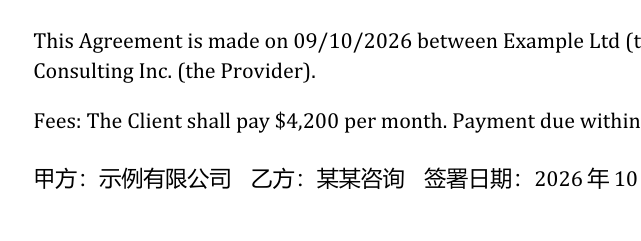 | 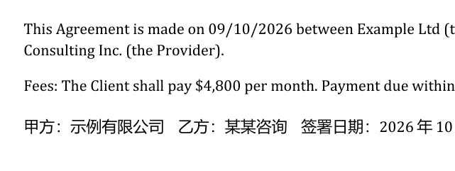 |

Source: Microsoft Word document, page 1.

```json
{
  "edits": [
    {
      "find": "$4,200",
      "replace": "$4,800"
    }
  ]
}
```

Engine reported: `status: done`, 1 change(s), `pages_billed: 1`.

## 02. Delete a phrase and tidy what it leaves behind

`op: delete` removes the street address; `options.tidy` collapses the double space and the stranded comma instead of leaving a gap.

| before | after |
| --- | --- |
| 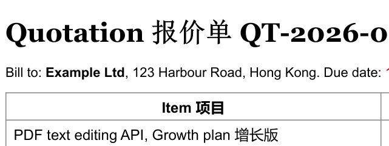 | 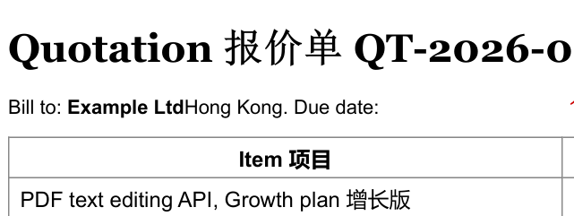 |

Source: Chromium print-to-PDF document, page 1.

```json
{
  "edits": [
    {
      "op": "delete",
      "find": "123 Harbour Road, "
    }
  ],
  "options": {
    "tidy": true
  }
}
```

Engine reported: `status: done`, 1 change(s), `pages_billed: 1`.

## 03. Replace and restyle in one edit

`style` sets the replacement's colour; `fit: auto` reports whether the new text had to be compressed to keep the line's layout.

| before | after |
| --- | --- |
| 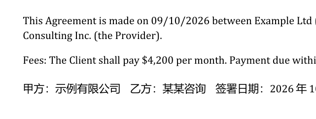 | 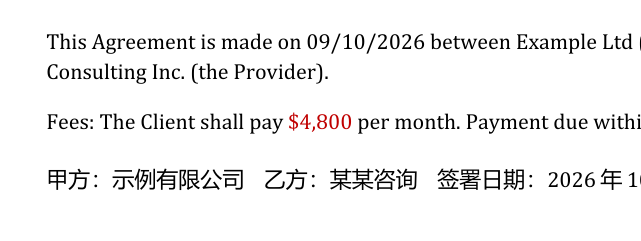 |

Source: the same document, page 1.

```json
{
  "edits": [
    {
      "find": "$4,200",
      "replace": "$4,800",
      "style": {
        "color": "#c00000"
      }
    }
  ]
}
```

Engine reported: `status: done`, 1 change(s), `pages_billed: 1`.

## 04. Redact an address before handing the file to a model

The text is removed from the content stream and the pixels under the box are scrubbed -- not covered with a black rectangle. `redaction.found_in` reports anywhere else the string still occurs.

| before | after |
| --- | --- |
| 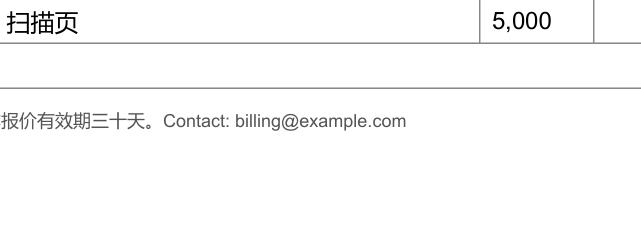 | 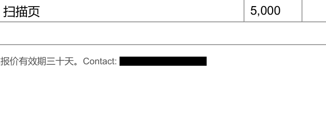 |

Source: the same document, page 1.

```json
{
  "edits": [
    {
      "op": "redact",
      "find": "billing@example.com"
    }
  ],
  "options": {
    "redact_metadata": true
  }
}
```

Engine reported: `status: done`, 1 change(s), `pages_billed: 1`.

## 05. Insert a clause below the signature block

`at.x`/`at.y` is the baseline origin of the new line -- the same coordinate a span's `origin` is reported in, so a position read out of `/v1/text` can be used here unchanged. The style is inherited from the nearest text, and the engine checks the page's own paper colour at the insertion point rather than overprinting ink. (`at.after` anchors on existing text instead; a `below` insert is refused when the next line already sits there.)

| before | after |
| --- | --- |
| 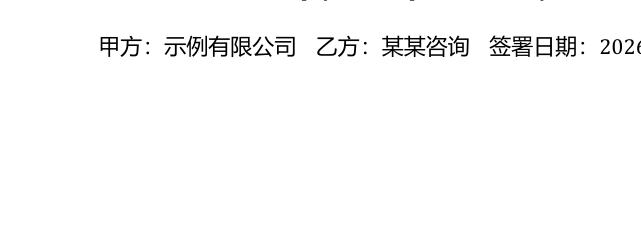 | 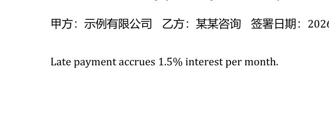 |

Source: the same document, page 1.

```json
{
  "edits": [
    {
      "op": "insert",
      "text": "Late payment accrues 1.5% interest per month.",
      "at": {
        "page": 1,
        "x": 90,
        "y": 240
      }
    }
  ]
}
```

Engine reported: `status: done`, 1 change(s), `pages_billed: 1`.

## 06. Fill an AcroForm field, appearance and all

`op: form` writes the field's value and reads `/V` back after reopening the document, so the value is in the file and not only in the appearance stream.

| before | after |
| --- | --- |
|  |  |

Source: a synthetic test fixture, page 1.

```json
{
  "edits": [
    {
      "op": "form",
      "fields": {
        "applicant": "Zhang Wei"
      }
    }
  ]
}
```

Engine reported: `status: done`, 1 change(s), `pages_billed: 1`.

## 07. A longer replacement relines the whole paragraph

`fit: reflow` re-wraps the paragraph in its own measured alignment, leading and column -- and measures the room below BEFORE erasing anything, so the paragraph underneath does not move.

| before | after |
| --- | --- |
| 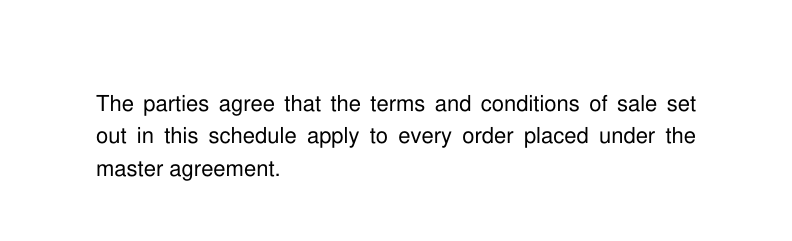 | 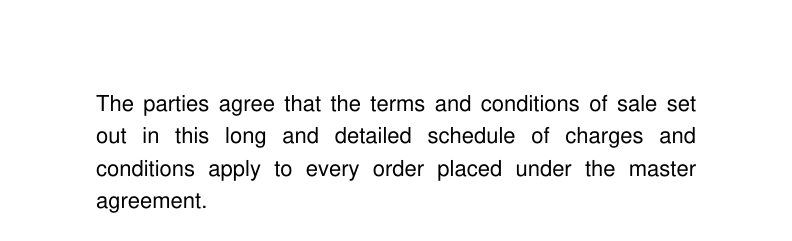 |

Source: a synthetic test fixture, page 1.

```json
{
  "edits": [
    {
      "find": "sale set out in this schedule",
      "replace": "sale set out in this long and detailed schedule of charges and conditions",
      "fit": "reflow",
      "match": {
        "across_lines": true
      }
    }
  ]
}
```

Engine reported: `status: done`, 1 change(s), `pages_billed: 1`, notes `['reflow_relined']`.

## 08. A date split across two fonts is still one match

`Renewal: 2025-` is one span and `10-01` the next, in a different font. The matcher works on the line, so the phrase is found; the rewrite splits into runs so the untouched spans do not move.

| before | after |
| --- | --- |
| 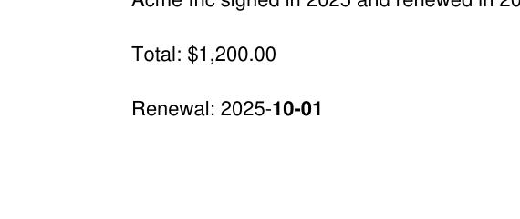 | 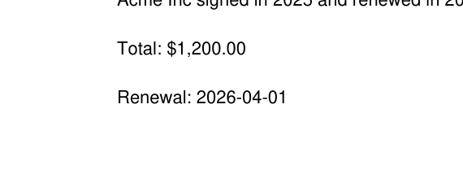 |

Source: a synthetic test fixture, page 2.

```json
{
  "edits": [
    {
      "find": "Renewal: 2025-10-01",
      "replace": "Renewal: 2026-04-01",
      "scope": {
        "pages": "2"
      }
    }
  ]
}
```

Engine reported: `status: done`, 1 change(s), `pages_billed: 1`.

## 09. A header shared by three pages, edited on one

The header is one Form XObject drawn on every page. Editing page 1 un-shares it first and notes `unshared_xobject`, so pages 2 and 3 keep the original header instead of silently changing too.

| before | after |
| --- | --- |
|  |  |

Source: a synthetic test fixture, page 1.

```json
{
  "edits": [
    {
      "find": "HEADER 2025 Report",
      "replace": "HEADER 2026 Report",
      "scope": {
        "pages": "1"
      }
    }
  ]
}
```

Engine reported: `status: done`, 1 change(s), `pages_billed: 1`, notes `['unshared_xobject']`.

## 10. A regex over a matplotlib-rendered invoice number

`match.mode: regex` (linear time, no lookaround) against text a plotting library emitted one glyph at a time.

| before | after |
| --- | --- |
| 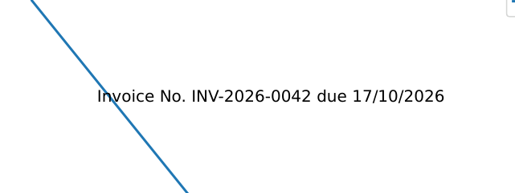 | 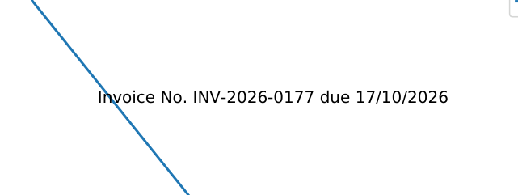 |

Source: matplotlib, Type 42 document, page 1.

```json
{
  "edits": [
    {
      "find": "INV-2026-00\\d\\d",
      "replace": "INV-2026-0177",
      "match": {
        "mode": "regex"
      }
    }
  ]
}
```

Engine reported: `status: done`, 1 change(s), `pages_billed: 1`.

---

Fonts: a replacement is set in the document's own font where the file embeds
enough of it, in a metric-compatible twin where it does not, and the result
says which (`font_source`, `font_used`). The examples here were rendered on
one machine with one font set; `font_source` on your documents depends on
yours. See [the honest limits](../index.md#what-it-refuses-to-do).
